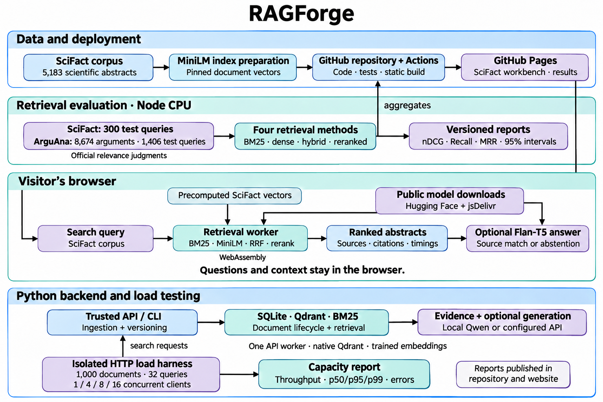

# RAGForge

[](https://github.com/Sashankpotluru/RAGForge/actions/workflows/ci.yml)

RAGForge searches documents, retrieves useful passages, and ties answers back to
their sources. It combines vector search with BM25, merges their rankings, and
can rerank the results before passing evidence to a language model.

This repository contains a Python backend and a browser workbench. The public
workbench searches all **5,183 scientific abstracts in BEIR SciFact**. Reproducible
benchmarks compare four retrieval methods on **300 SciFact queries** and **1,406
ArguAna counterargument queries**, using the shared ranking engine and pinned
model artifacts. A separate HTTP load experiment measures the Python backend.

## Try it

**[Open the demo](https://sashankpotluru.github.io/RAGForge/)**

Enter a scientific claim or choose an example, compare retrieval modes, and read
the returned abstracts. The collection contains evidence that can support or
refute a claim; a high search rank is not a verdict that the claim is true.

The hosted demo runs on GitHub Pages. Keyword search uses the downloaded corpus.
Neural search loads precomputed document vectors and embeds your query; it does
not embed thousands of abstracts on each visit. Model answers are optional. The
page explains the downloads before loading model weights. No account or API key
is needed.

Queries and retrieved text stay in the browser. The page does not connect to a
private index. Optional model inference requires a supported browser and enough
memory. The benchmark measures document retrieval; it does not score generated
answers or verify scientific claims. [Browser setup and limitations](docs/browser-demo.md)

## What's in the backend

- **Document ingestion:** PDF, Markdown, HTML and plain text, with bounded chunks
  and source offsets. HTTPS ingestion is optional and restricted to allowed hosts.
- **Hybrid retrieval:** dense vectors in Qdrant, a persisted BM25 index, reciprocal
  rank fusion, and an optional cross-encoder reranker.
- **Document lifecycle:** SQLite tracks active versions. Repeated ingestion is a
  no-op, replacements are staged, and failed updates can be recovered.
- **Cited answers:** quotes and identifiers travel with retrieval results. A
  configured chat-completions provider can answer questions or rewrite queries.
- **Evaluation:** versioned fixtures, separate baselines, per-question results,
  model revisions, and clearly defined timing boundaries.

The code uses explicit components so each ranking stage and failure path can be
inspected. [Implementation decisions](docs/implementation-notes.md)

## Run the sample UI locally

Run the Python-backed sample workbench locally with an empty dedicated storage
directory. This quick smoke-test app retains the six synthetic policy documents.

```bash
uv sync --locked
uv run --no-sync ragforge demo --data-dir data/public-demo --port 8787
```

Open [the workbench](http://127.0.0.1:8787). The [local demo guide](docs/demo.md)
covers neural retrieval and running Qwen on your own machine.
To preview the GitHub Pages edition, follow the [static build instructions](docs/browser-demo.md#preview-a-project-site-build).

## Run the backend

Use Python 3.12 or 3.13 and uv 0.13.9. Run from the repository root.

```bash
python3 -m pip install uv==0.13.9
uv sync --locked --extra dev
uv run --no-sync ragforge ingest data/fixtures/sample.md
uv run --no-sync ragforge search "What does this document describe?"
uv run --no-sync ragforge evaluate --output results/fixture.json
uv run --no-sync ragforge serve
```

Visit [OpenAPI documentation](http://127.0.0.1:8000/docs) while the server runs. The default uses embedded Qdrant and a deterministic token-hash embedding. After installation the default retrieval and evaluation paths run offline. Use the service HTTP endpoints for concurrent clients. Stop the server before opening the same embedded data directory from another CLI process.

```bash
curl -sS http://127.0.0.1:8000/v1/documents -H 'Content-Type: application/json' \
  -d '{"source":"memory:guide","content":"Violet flowers grow in the garden.","metadata":{"team":"garden"}}'
curl -sS http://127.0.0.1:8000/v1/search -H 'Content-Type: application/json' \
  -d '{"query":"flowers","collection":"default","mode":"hybrid","metadata_filter":{"conditions":[{"field":"team","operator":"eq","value":"garden"}]}}'
```

## API reference

| Interface | Behavior |
|---|---|
| POST /v1/documents | Supply source and content, or source, MIME type and file_base64. Optional collection and external_id identify a document across updates. |
| POST /v1/documents/url | Fetch a permitted HTTPS URL with redirects and bounded content. Disabled by default. |
| GET or DELETE /v1/documents/{document_id} | Inspect the active/staged version and failure state or remove the document. |
| POST /v1/search | Search one collection using dense, hybrid or hybrid_rerank mode. Optional query rewriting adds another ranking. |
| POST /v1/ask | Generate a cited answer from evidence using the configured provider. Returns 503 when unconfigured. |
| POST /v1/evaluations/run | Submit an empty JSON object to evaluate the packaged fixture and persist its results. |
| GET /healthz or /readyz | Inspect process health or Qdrant collection availability. |

Use `ragforge --help` for CLI commands. Configure retrieval models and optional providers through the environment. [Operations runbook](docs/runbook.md)

## What the evaluation shows

The SciFact benchmark compares BM25, dense retrieval, hybrid fusion and
cross-encoder reranking across the complete collection. Settings are fixed before
the test run. Published artifacts include per-query rankings, model and data
hashes, timings, bootstrap intervals, and comparisons against BM25.

| Method | nDCG@10 | MRR@10 | Recall@10 | Recall@100 | Median search |
| --- | ---: | ---: | ---: | ---: | ---: |
| BM25 | 0.6629 | 0.6316 | 0.7833 | 0.8826 | 0.95 ms |
| Dense MiniLM | 0.6465 | 0.6056 | 0.7867 | 0.9250 | 6.46 ms |
| Hybrid (RRF) | 0.6802 | 0.6448 | 0.8096 | 0.9550 | 6.68 ms |
| Hybrid + reranking | 0.6809 | 0.6484 | 0.8096 | 0.9550 | 466.54 ms |

Hybrid retrieved more of the judged relevant papers within its first 100 results.
Its nDCG@10 improvement over BM25 was 0.0173, with a paired 95% bootstrap interval
of −0.0055 to +0.0398. That interval includes zero. Reranking added little average
ranking quality while taking roughly 70 times as long as hybrid search in this
run. Those trade-offs matter more than declaring one method the winner.

All 300 queries completed in all four modes. An independent `trec_eval` audit
matched all **6,000 per-query metric values** exactly.

The [SciFact evaluation](docs/scifact-evaluation.md) explains the protocol and
results. This measures the browser retrieval implementation under Node.js CPU
inference, not the Python API's ingestion or Qdrant throughput. Browser inference
uses WebAssembly, so live latency depends on the visitor's device.

The original [six-document Python fixture](docs/evaluation.md) remains a regression
check. Its near-perfect scores are not the headline benchmark.

### A second task: finding counterarguments

ArguAna contains **8,674 arguments and 1,406 test queries**. It asks the system
to find a relevant counterargument, which is a different task from finding
scientific evidence. The settings and model revisions are the same as SciFact's.

| Method | nDCG@10 | MRR@10 | Recall@10 | Recall@100 | Median search |
| --- | ---: | ---: | ---: | ---: | ---: |
| BM25 | 0.4209 | 0.3358 | 0.6942 | 0.9189 | 9.05 ms |
| Dense MiniLM | 0.5002 | 0.4114 | 0.7859 | 0.9787 | 11.11 ms |
| Hybrid (RRF) | 0.5024 | 0.4137 | 0.7866 | 0.9822 | 19.30 ms |
| Hybrid + reranking | 0.4809 | 0.3910 | 0.7724 | 0.9822 | 281.12 ms |

Hybrid improved nDCG@10 over BM25 by **0.0816**, with a paired 95% interval of
**[0.0707, 0.0925]**. Reranking lowered the mean score compared with hybrid and
cost about 14.6 times as much latency. Adding another model was not automatically
an improvement. All **28,120 per-query metric values** matched `trec_eval`.

The evaluator excludes query self-matches before ranking cutoffs and retains
five queries whose relevant documents are absent from the dataset. A token audit
also caught and corrected long-input truncation that could remove the candidate
from the reranker's input. Both benchmarks were measured again after that fix;
the earlier SciFact report remains available. [ArguAna protocol, results and limitations](docs/arguana-evaluation.md)

The live search collection remains SciFact. ArguAna appears in the Results view
as an offline benchmark, with links to its full report.

### Python API under concurrent requests

The load harness ingests **1,000 SciFact documents** through the real API, then
searches them using **32 distinct training-split queries**. It runs three
30-second trials each at **1, 4, 8 and 16 concurrent clients**, with trained CPU
embeddings, SQLite, native Qdrant and one Uvicorn worker. All request observations
and trial summaries are saved, including failures and drain time.

| Concurrent clients | Successful req/s | p95 latency | Failed requests |
| --- | ---: | ---: | ---: |
| 1 | 7.84 | 205 ms | 0 / 707 |
| 4 | 8.14 | 601 ms | 0 / 743 |
| 8 | 8.12 | 1,087 ms | 0 / 753 |
| 16 | 7.99 | 2,171 ms | 0 / 764 |

All **2,967 measured requests succeeded**. More clients mainly increased
latency; throughput stayed near eight requests per second. This is consistent
with the backend's serialized retrieval path, and gives a concrete reason to
measure and redesign that boundary before scaling the service.

These measurements cover warm, read-only HTTP search on one machine. They do
not measure GitHub Pages traffic or establish an internet SLA, authenticated
multi-user access or maximum production capacity. The tiny embedding model also
differs from the browser's MiniLM. [Load protocol, results and reproduction](docs/load-testing.md)

## Architecture



GitHub Actions builds the website and publishes it to GitHub Pages. Retrieval and
optional model inference run in the visitor's browser. The full Python backend
remains in this repository and can be run separately; it is not a service hosted
by GitHub Pages. [Architecture and data flow](docs/architecture.md)

## Tests and containers

```bash
uv run --no-sync pytest
uv run --no-sync ruff check .
uv run --no-sync ruff format --check .
uv run --no-sync mypy src
docker compose up --build -d
```

CI runs the Python tests, type checks, fixture evaluation, and integration checks
against Docker Compose and Qdrant. The browser demo has separate ranking tests and
static build checks. [Verification record](docs/verification.md)

## Project layout

| Path | Contents |
| --- | --- |
| `src/ragforge/` | Python ingestion, storage, retrieval, generation and API |
| `src/ragforge/demo/` | Shared workbench UI and isolated Python demo |
| `web/` | Browser retrieval, model runtime, tests and Pages build |
| `benchmarks/` | Dataset preparation, retrieval evaluation, API load harness and public summaries |
| `tests/` | Python unit, contract and integration tests |
| `evaluations/results/` | Recorded measurements and provenance |
| `docs/` | Design decisions, setup, operations and limitations |

[Architecture diagram](docs/architecture.md) · [Verification](docs/verification.md) · [Security and trust boundaries](docs/security.md) · [Implementation decisions](docs/implementation-notes.md)

The backend is designed for one trusted operator. The browser workbench searches
a fixed public research collection. Original code is MIT licensed; benchmark data,
PDF extraction and model weights have separate terms.
[License](LICENSE) · [Third-party notices](THIRD_PARTY_NOTICES.md)
