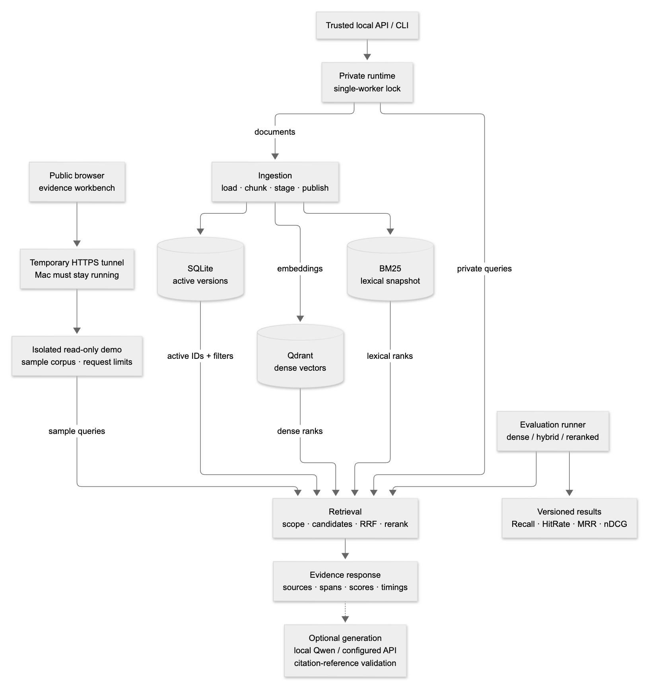

# RAGForge

[](https://github.com/Sashankpotluru/RAGForge/actions/workflows/ci.yml)

A single-worker hybrid retrieval service for local document collections. Ingest PDF, Markdown, HTML, text or allowlisted HTTPS sources. Search returns ranked chunks, source locations, quotes, and the rank contributed by each retrieval branch. Optional models add semantic retrieval, cross-encoder reranking, query rewriting and cited answers.

## Public sample workbench

Run the browser demo locally with an empty dedicated storage directory. Its six synthetic documents are bundled with the application.

```bash
uv sync --locked
uv run --no-sync ragforge demo --data-dir data/public-demo --port 8787
```

Open [the workbench](http://127.0.0.1:8787). For neural retrieval, free local answer generation, and a temporary public link, follow the [demo guide](docs/demo.md).

## Run locally

Use Python 3.12 or 3.13 and uv 0.13.9. Run from the repository root.

```bash
python3 -m pip install uv==0.13.9
uv sync --locked --extra dev
uv run --no-sync ragforge ingest data/fixtures/sample.md
uv run --no-sync ragforge search "What does this document describe?"
uv run --no-sync ragforge evaluate --output results/fixture.json
uv run --no-sync ragforge serve
```

Visit [OpenAPI documentation](http://127.0.0.1:8000/docs) while the server runs. The default uses embedded Qdrant and a deterministic token-hash embedding. After installation the default retrieval and evaluation paths run offline. Use the service HTTP endpoints for concurrent clients. Stop the server before opening the same embedded data directory from another CLI process.

```bash
curl -sS http://127.0.0.1:8000/v1/documents -H 'Content-Type: application/json' \
  -d '{"source":"memory:guide","content":"Violet flowers grow in the garden.","metadata":{"team":"garden"}}'
curl -sS http://127.0.0.1:8000/v1/search -H 'Content-Type: application/json' \
  -d '{"query":"flowers","collection":"default","mode":"hybrid","metadata_filter":{"conditions":[{"field":"team","operator":"eq","value":"garden"}]}}'
```

## Interfaces

| Interface | Behavior |
|---|---|
| POST /v1/documents | Supply source and content, or source, MIME type and file_base64. Optional collection and external_id identify a document across updates. |
| POST /v1/documents/url | Fetch a permitted HTTPS URL with redirects and bounded content. Disabled by default. |
| GET or DELETE /v1/documents/{document_id} | Inspect the active/staged version and failure state or remove the document. |
| POST /v1/search | Search one collection using dense, hybrid or hybrid_rerank mode. Optional query rewriting adds another ranking. |
| POST /v1/ask | Generate a cited answer from evidence using the configured provider. Returns 503 when unconfigured. |
| POST /v1/evaluations/run | Submit an empty JSON object to evaluate the packaged fixture and persist its results. |
| GET /healthz or /readyz | Inspect process health or Qdrant collection availability. |

Use `ragforge --help` for CLI commands. Configure retrieval models and optional providers through the environment. [Operations runbook](docs/runbook.md)

## Evaluation and operations

The checked-in evaluation uses six original synthetic documents and twelve labeled questions. It exercises both offline retrieval and real, revision-pinned tiny models. The metrics describe this fixture only. [Methods and measurements](docs/evaluation.md)

| Neural retrieval | Hit rate@1 | MRR@10 | Recall@1 |
| --- | ---: | ---: | ---: |
| Dense | 83.3% | 0.889 | 79.2% |
| Hybrid | 91.7% | 0.958 | 87.5% |
| Hybrid + cross-encoder | 100.0% | 1.000 | 95.8% |

These are fixture results, not estimates of performance on a general document
collection. Three [local generation examples](evaluations/results/local-generation-v1.json)
also record the actual answers, matching evidence, pinned model and timings.



[Architecture diagram](docs/architecture.md) · [Verification](docs/verification.md) · [Security and trust boundaries](docs/security.md) · [Implementation decisions](docs/implementation-notes.md)

The backend is designed for one trusted operator. The separate browser workbench exposes a fixed sample corpus. Original code is MIT licensed. PDF extraction and optional model weights have separate terms. [License](LICENSE) · [Third-party notices](THIRD_PARTY_NOTICES.md)
