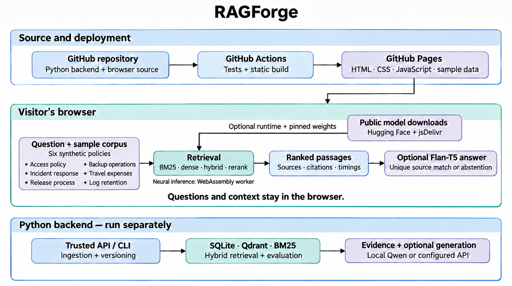
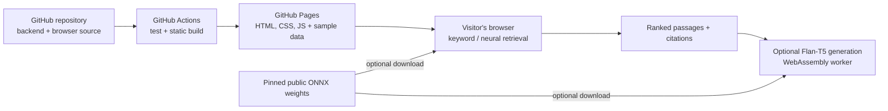
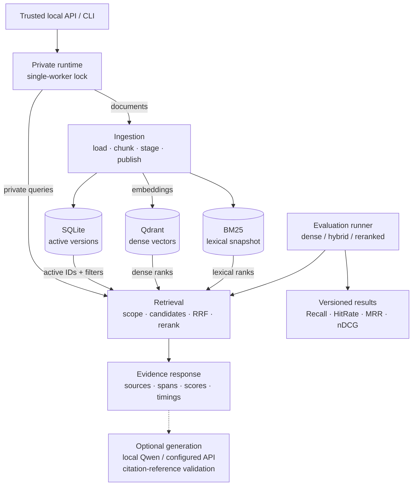

# RAGForge architecture

RAGForge has two execution paths: a public browser workbench hosted on GitHub
Pages and a Python backend that can be run separately. Both implementations live
in the same GitHub repository. The website does not depend on the Python service.

## Deployment diagram

GitHub Actions tests the code, builds an allowlisted static artifact, and deploys
that artifact to GitHub Pages. The visitor's browser loads the workbench and six
synthetic policies. Keyword search is ready immediately; neural retrieval and
answer generation download their models only when requested.

The sample policies are Access policy, Backup operations, Incident response,
Travel expenses, Release process, and Log retention. They are original synthetic
documents bundled with the project.

## Current public hosting

GitHub Pages serves static files; it does not run FastAPI, SQLite, Qdrant, or a
Python model server. The browser edition searches the packaged sample corpus in
memory. Its model downloads come from public model repositories, while questions
and retrieved context stay in the browser. The public URL has no dependency on
the maintainer's computer or the former tunnel.

The browser and Python implementations have separate model configurations. The
checked-in retrieval measurements belong to the Python backend. Browser timings
are measured during each request and depend on the visitor's device.

Python backend components

The API and CLI compose the same Python components. SQLite owns which document
versions are visible; Qdrant and BM25 supply rankings for eligible chunks. Private
queries and the evaluation runner both call the retrieval service.

The optional local Python sample app constructs its own fresh runtime and
sample-only stores. It never mounts the private API or reads an existing user
index. Only the trusted API/CLI can ingest arbitrary documents. The Python sample
app has no mutation routes. It is a separate way to run the workbench locally.

Solid lines show the core path. Dashed lines require an enabled answer provider.
Dense-only evaluation bypasses BM25/fusion; hybrid evaluation adds BM25 and RRF;
the reranked configuration also reranks the fused candidates.

The [PNG](architecture-pages.png) is the presentation diagram used in the README and
website. The Mermaid references provide editable descriptions of the deployment
and backend paths.

## Consistency boundary

One runtime lock serializes index mutations and retrieval snapshots within one
process. Run one API worker, and do not run a second process against the same data
directory. This deliberately favors a comprehensible consistency model over
throughput. It is not a distributed transaction or multi-worker service.

For replacement, the prior active chunks remain visible while the new version is
staged. Vector upserts and the lexical snapshot must succeed before the SQLite
active-version pointer is promoted. Search restricts vector candidates to active,
eligible chunk identifiers **before** applying the candidate limit. Failed or
obsolete versions therefore cannot consume result slots. The shared metadata
predicate is applied before retrieval in both branches.

SQLite retains normalized chunk text, source locations, and spans. Startup uses
the catalog to recover the lexical snapshot and discard staged/inactive data;
recovery does not silently download source documents. This is recoverable
coordination across independent stores, not an atomic transaction spanning all
three stores.

## ADR-001: Explicit retrieval components

**Status:** Accepted for the initial backend milestone  
**Date:** 2026-11-18

### Context

The portfolio needs inspectable ranking, lifecycle behavior, and reproducible
measurements. The backend is local and single-node. A separate read-only web demo
exposes a synthetic sample corpus. A browser edition is hosted on GitHub Pages;
tenant authorization, managed Python hosting, and distributed workers remain
outside the release scope.

### Decision

Use a small Python composition layer with independently testable loaders,
embedding adapters, Qdrant storage, BM25 scoring, fusion, rerankers, citation
assembly, and evaluation. Keep SQLite authoritative for version visibility.

### Alternatives and trade-offs

| Option | Benefit | Cost in this milestone |
| --- | --- | --- |
| Explicit components, selected | Ranking and failure behavior are visible and testable | More lifecycle code to own |
| Framework-owned RAG chain | Faster initial orchestration | More behavior hidden behind framework defaults |
| Distributed search and worker services | Greater scaling flexibility | More failure modes and deployment dependencies |

### Consequences

The offline path can run without credentials or model downloads. Its hash
embedding is a test/demo mechanism, not a neural model or evidence of semantic
retrieval quality. The default path does not rerank. Real SentenceTransformer
embedding and CrossEncoder reranking adapters are separate, optional dependencies.

The local BM25 snapshot and active-ID filtering prioritize correctness and
auditability at a small scale. Larger corpora need measured capacity testing,
more efficient metadata indexing, and a coordinated distributed visibility
protocol before increasing worker count.

## Trust boundaries

- Source text is untrusted data, including instructions embedded in documents.
  Retrieval is not permission to execute those instructions.
- Source-bound citations establish provenance. Valid citation identifiers do not
  establish that generated claims are entailed by the cited text.
- External generation and rewriting are opt-in. A provider receives retrieved
  text; check data-sharing requirements before enabling it.
- Metadata filtering is a search feature, not tenant authorization. Do not expose
  the private administration API directly to the public internet. The dedicated
  demo app exposes only sample data, with body/query limits, a global request
  budget, and bounded concurrency.
- Model, chunking, and index configuration changes require an explicit reindex
  into a new data directory/collection rather than mixing incompatible vectors.

See [security](security.md), [operations](runbook.md),
[evaluation methodology](evaluation.md), and
[implementation decisions](implementation-notes.md) for the release-specific
contracts and limitations.

## Upstream references

- [Qdrant filtering](https://qdrant.tech/documentation/search/filtering/)
- [SentenceTransformer API](https://sbert.net/docs/package_reference/sentence_transformer/model.html)
- [CrossEncoder API](https://www.sbert.net/docs/package_reference/cross_encoder/model.html)
